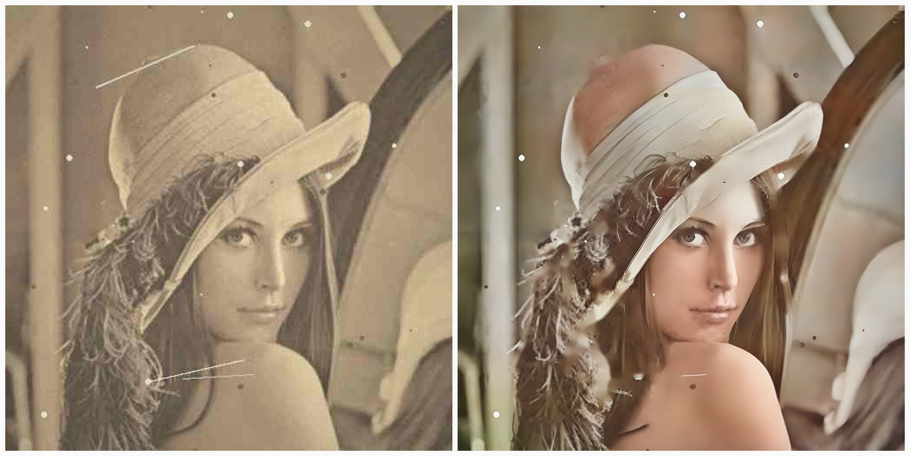

# AI Photo Restoration & Captioning

A local, inference-only photo restoration app built with pretrained models. It
upscales, denoises, sharpens faces, corrects faded color, optionally colorizes
old photos, and generates a caption — all running on Apple Silicon (MPS) with a
Streamlit interface.

No training and no personal photo dataset required.



*Synthetic old-photo input (left) and restored output (right): Real-ESRGAN x4,
face enhancement, auto color correction, colorization, and dust/scratch reduction.*

---

## Features

| Feature | Model / method |
|---|---|
| Super-resolution x2 / x4 | Real-ESRGAN x4plus via `spandrel` |
| Denoise / deblur / JPEG repair | Real-ESRGAN (implicit) |
| Face detection | OpenCV YuNet ONNX |
| Face enhancement | GFPGAN v1.4 (optional) or Real-ESRGAN face crops |
| Auto color / contrast | Classical gray-world + CLAHE |
| Dust & scratch reduction | Morphology + Hough lines + OpenCV inpainting (experimental) |
| Colorization | SIGGRAPH 2017 colorizer |
| Captioning | BLIP base |
| Tiled inference | Overlapping tiles with feathered blending |
| UI | Streamlit with before/after slider and batch ZIP export |

Everything runs locally. Uploaded images are not sent to a server or persisted.

---

## Quickstart

Tested with **Python 3.12** on an Apple M2 (8 GB) with PyTorch MPS.

```bash
cd /Users/harshitkumar/Downloads/Coding/Projects/dl_project

python3.12 -m venv .venv
source .venv/bin/activate
pip install --upgrade pip
pip install -r requirements.txt
```

Download the models:

```bash
python scripts/download_weights.py --with-colorizer
```

Optional: prefetch the BLIP captioner (otherwise it downloads on first use):

```bash
python scripts/download_weights.py --with-caption
```

Build the demo images and a small evaluation set:

```bash
python scripts/make_synthetic_old.py --input assets --out data/demo --all
python scripts/make_eval_set.py
```

Run the app:

```bash
streamlit run app/streamlit_app.py
```

Open <http://localhost:8501>. The sidebar controls upscale factor, face
enhancement, auto color/contrast, scratch reduction, colorization, and
captioning.

---

## Command line

```bash
# Restore + caption
python -m src.cli process assets/sample_scene.jpg --scale 4

# Old portrait with all restoration features
python -m src.cli process data/demo/sample_portrait_old.jpg \
  --scale 4 --colorize --scratch -o outputs/portrait.png

# Faster 2x mode without face enhancement or caption
python -m src.cli process input.jpg --scale 2 --no-face --no-caption
```

Results are written to `outputs/` by default. Add `--json` for full metadata.

| Flag | Meaning |
|---|---|
| `--scale {2,4}` | Upscale factor (default 4) |
| `--max-side N` | Cap input size before upscaling (default 1024) |
| `--tile-size N` / `--overlap N` | Tiled inference settings |
| `--no-face` | Disable face enhancement |
| `--no-enhance` | Disable auto color/contrast |
| `--scratch` | Experimental dust/scratch reduction |
| `--colorize` | Colorize grayscale/faded photo |
| `--no-caption` | Disable BLIP captioning |
| `--device {mps,cuda,cpu}` | Force a device |

---

## How it works

```
Upload
  → normalize (EXIF, RGB, alpha, size cap)
  → optional dust/scratch reduction
  → tiled Real-ESRGAN x2/x4
  → YuNet face detection → GFPGAN (or face-crop Real-ESRGAN)
  → auto color/contrast correction
  → optional SIGGRAPH colorization
  → optional BLIP caption
  → Streamlit preview, downloads, metadata
```

Large images are processed in overlapping 256×256 tiles (32 px overlap) and
blended with a feathered mask to stay inside 8 GB of unified memory.

---

## Project structure

```
dl_project/
├── app/
│   └── streamlit_app.py      # Streamlit UI
├── src/
│   ├── cli.py                # Command-line entry point
│   ├── pipeline.py           # End-to-end orchestration
│   ├── restore.py            # Real-ESRGAN wrapper
│   ├── tiling.py             # Overlapping tiled inference
│   ├── faces.py              # YuNet detection + face enhancement
│   ├── enhance.py            # Auto color/contrast
│   ├── scratch.py            # Experimental dust/scratch reduction
│   ├── colorize.py           # SIGGRAPH colorizer wrapper
│   ├── caption.py            # BLIP captioning
│   ├── preprocess.py         # Image normalization
│   ├── models.py             # Lazy model manager
│   └── colorizers/           # Vendored colorizer architecture
├── scripts/
│   ├── download_weights.py
│   ├── make_synthetic_old.py # Synthetic old-photo generator
│   └── make_eval_set.py      # Deterministic SR evaluation set
├── eval/
│   ├── metrics.py            # PSNR, SSIM, LPIPS
│   └── evaluate.py           # Bicubic vs Real-ESRGAN benchmark
├── tests/                    # 16 pytest tests
├── assets/                   # Sample images + README figure
├── data/                     # Generated demos/eval set (gitignored)
├── weights/                  # Model weights (gitignored)
└── outputs/                  # Restored images (gitignored)
```

---

## Evaluation

Run:

```bash
python eval/evaluate.py
```

The evaluation set contains 24 crops from six public scikit-image photos, each
rendered at 256×256 and downscaled 4× in two variants:

- **clean** — bicubic downscale only
- **old** — downscale plus synthetic fade, blur, noise, JPEG, scratches, vignette

| Group | Metric | Bicubic | Real-ESRGAN | Better? |
|---|---|---:|---:|---|
| Clean | PSNR ↑ | **33.74 dB** | 29.87 dB | No |
| Clean | SSIM ↑ | **0.8436** | 0.8000 | No |
| Clean | LPIPS ↓ | 0.2835 | **0.1371** | **Yes** (−52%) |
| Old | PSNR ↑ | **12.67 dB** | 12.10 dB | No |
| Old | SSIM ↑ | 0.3420 | **0.3657** | **Yes** |
| Old | LPIPS ↓ | 0.8726 | **0.6783** | **Yes** (−22%) |

**Interpretation:** Real-ESRGAN is a perceptual model. It produces sharper,
more natural texture and much better LPIPS, but it does not minimize pixel-wise
error, so PSNR is lower than bicubic on clean synthetic downscales. This is the
classic distortion–perception tradeoff, not a bug. See
[`docs/EVALUATION.md`](docs/EVALUATION.md) for methodology and caveats.

---

## Models and licenses

| Component | Weights | License |
|---|---|---|
| Real-ESRGAN x4plus | `RealESRGAN_x4plus.pth` | BSD-3-Clause |
| GFPGAN v1.4 (optional) | `GFPGANv1.4.pth` | Apache-2.0 |
| BLIP base | Hugging Face | BSD-3-Clause |
| SIGGRAPH 2017 colorizer | `siggraph17-df00044c.pth` | BSD-2-Clause |
| OpenCV YuNet | `face_detection_yunet_2023mar.onnx` | Apache-2.0 |

See [`docs/ATTRIBUTION.md`](docs/ATTRIBUTION.md) for citations. Check licenses
before commercial use.

### Optional GFPGAN

GFPGAN can be installed with `pip install gfpgan`, but its old `basicsr`
dependency sometimes conflicts with recent PyTorch/torchvision. If it is not
installed, the app automatically falls back to Real-ESRGAN on detected face
crops. The fallback is not identity-aware but still sharpens faces.

---

## Limitations

- **Scratches:** the classical detector is experimental and can erase fine
  texture. Compare with it off; it is not a learned inpainting model.
- **Faces:** enhancement can change identity and over-smooth skin. Keep the
  toggle available and disclose AI edits.
- **Colorization:** predicts plausible, not historically accurate, colors.
- **Captions:** BLIP can hallucinate details. Treat captions as suggestions.
- **PSNR:** Real-ESRGAN does not beat bicubic on pixel accuracy; use perceptual
  metrics and human evaluation.
- **Real historical photos:** the demo/test set is synthetic. Real prints have
  damage types not covered here (creases, mold, missing regions).
- **8 GB RAM:** large inputs are capped and tiled. Close other memory-heavy apps.

---

## Privacy

- Processing is local; uploads are not sent anywhere.
- Outputs are saved without EXIF metadata.
- Batch results are held in memory and downloaded by the user.
- Do not process sensitive images on a shared machine.

---

## Development

```bash
pytest -q                 # run tests
python eval/evaluate.py   # benchmark
python scripts/download_weights.py --with-colorizer --with-caption
```

Useful environment variables:

```bash
export PHOTO_DEVICE=mps          # force device
export PHOTO_MAX_SIDE=1024       # default input cap
export PYTORCH_ENABLE_MPS_FALLBACK=1  # debug unsupported MPS ops (slow)
```

### Troubleshooting

| Problem | Fix |
|---|---|
| `Restorer weights not found` | `python scripts/download_weights.py --with-colorizer` |
| MPS unavailable | Check `torch.backends.mps.is_available()`; CPU works but is slower |
| MPS op fallback | Try a smaller `--max-side`; set `PYTORCH_ENABLE_MPS_FALLBACK=1` to diagnose |
| GFPGAN import error | Skip it; the face-crop fallback is automatic |
| BLIP download fails | Check network/HF access; the rest of the app still works |
| Streamlit slider blank | The comparison component loads a CDN; the side-by-side tab still works |
| Out of memory | Lower `--max-side`, use `--scale 2`, reduce `--tile-size` |
| Docker on Mac is slow | Docker Desktop has no Metal/MPS; run natively for the demo |

---

## Notes

- `weights/`, `data/`, `outputs/`, and `.cache/` are gitignored.
- The project does **not** train any model. All weights are pretrained.
- The colorizer architecture is vendored from `richzhang/colorization` (BSD-2)
  with a small OpenCV-based Lab preprocessing wrapper.
